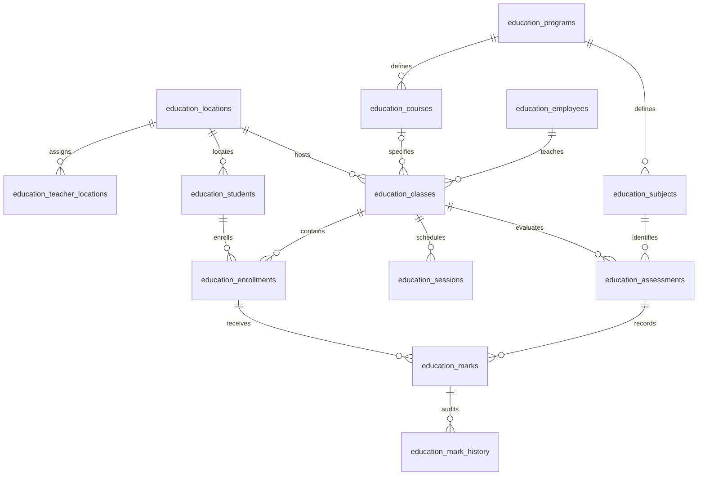

# Catalog, enrollment, and assessment upgrade (migration 004)

Status: implemented and tested locally; not applied to a hosted project by this agent. Deploy only after testing in the disposable module project. The current live main branch is not automatically upgraded.

## Confirmed domain rules

- Locations: Ndeja, Kura, Metuchira.
- Programs: Vocational Training and Cram School.
- Vocational courses: Electricity, Mechanics, Sewing, Bakery.
- Cram classes: grades 1–8, morning/afternoon shift, academic year.
- Cram subjects: Mathematics, Portuguese, Social Science, Aphorism.
- Each teacher has one current location; administrators manage all three.
- Only assigned teachers record student attendance. Administrators record staff attendance.
- One ACTIVE vocational enrollment per student, across all classes/locations.
- Assessment marks are numeric values from 0 through 20, inclusive. Decimal marks are supported.

Assessment workflow default: the assigned teacher creates assessments and records/corrects marks; administrators read results and history. No approval workflow or calculated final average is introduced.

## Ordered deployment

1. Confirm the disposable development project and an existing module administrator. Apply migrations 001–003 first only if they are not already applied.
2. Review and run the complete `migrations/20261028000400_catalog_enrollment_assessment.sql` once in SQL Editor. It is transactional and fails on object conflicts. It does not import the source project's `tcm_train` tables or bigint IDs.
3. Deploy the matching frontend, including **catalog.js** alongside app.js, index.html, styles.css, and assets/. Migration 004 replaces earlier student/session writers with messages directing clients to the location/class-aware RPCs. Coordinate both steps; older clients cannot continue using the old write contracts.
4. Sign in as administrator. Under **Programs, locations and classes**, assign each approved teacher one location. A teacher with no location has no scoped teaching access.
5. Review old student profiles: Edit each and select its actual location. Migration does not guess a location or create enrollments from names.
6. Create classes: choose location, program, teacher, academic year, and either a vocational course or Cram grade/shift. Teacher options are limited to approved teachers at that location. Existing class definitions are preserved; use archive/new class rather than rewriting historical class identity.
7. Enroll students at the same location. Teachers may manage enrollment only for their own classes; administrators manage all classes. Enter the real enrolled date. End dates are the last eligible date, inclusive.
8. Create sessions for a class. Only enrolled students whose enrollment covers the session date appear in its attendance selector. The server independently checks this rule, the assigned teacher, and location.
9. For an older session, an administrator can use **Review a preserved session**. Select a class with its original teacher and ensure all existing attendance participants have eligible enrollments on the original date. Linking retains session/attendance IDs, teacher, date, and status. Unclassified legacy sessions remain available to administrators and are read-only for teaching until reviewed.
10. Sign in as the assigned teacher. Create an assessment with a matching subject/course and date, then record eligible students' marks. Use **Correct** for a saved mark. A stale revision is rejected; refresh and review the current mark instead of overwriting it blindly.

Do not rerun old migrations, drop existing tables, merge people by name, or broaden direct table grants as a workaround. Existing account/profile links, role approvals, and attendance records are retained. Preserve a normal project backup before rollout; after new writes, use a reviewed forward repair rather than dropping the new tables.

## Eligibility and lifecycle

An enrollment is eligible on a date when `enrolled_on <= date` and its inclusive end date is absent or not earlier than that date. Completed/withdrawn enrollments therefore remain eligible for historical corrections inside their recorded period. Ending an enrollment cannot invalidate already recorded attendance or marks.

Active enrollment requires an active student at the class location. Active vocational duplicates are rejected by a partial unique database index constrained to the class's program. Changing a student's location or deactivating the profile requires ending active enrollments first. Archiving a class requires ending its active enrollments. Archived classes cannot receive new sessions/assessments; authorized historical corrections remain possible.

A teacher transfer requires archiving their active classes. Historical class/session identities are not rewritten. Once transferred, the teacher's old-location access is removed; administrators retain access. Restoring a class requires its teacher still be approved at its location.

Role changes remain controlled by migration 003's approval/audit flow. This upgrade does not implement Portal identity exchange, suspension, global lock, or System Owner access. Portal and Education projects remain separate; agree verification and explicit identity mapping with the Portal owner before forwarding credentials between them.

## API package

All calls are authenticated POSTs to `/rest/v1/rpc/<function>` with the module user's token. Direct browser table access remains revoked and RLS is enabled. Exact SQL signatures and data types are authoritative in migration 004.

| RPC | Purpose |
| --- | --- |
| `education_domain_list(p_resource,p_offset,p_limit)` | Paginated permitted catalog/class/enrollment/assessment/mark/history reads; page size 1–500 |
| `education_assign_teacher_location(p_employee_id,p_location_id)` | Administrator assigns one location to an approved teacher |
| `education_save_student_profile(p_id,p_student_number,p_display_name,p_location_id,p_active)` | Create/edit a location-scoped student |
| `education_create_class(p_name,p_location_id,p_program_code,p_course_id,p_grade_level,p_shift,p_academic_year,p_teacher_id)` | Administrator creates a valid class with a local teacher |
| `education_set_class_active(p_class_id,p_active)` | Administrator archives/restores a class without deleting records |
| `education_save_enrollment(p_id,p_student_id,p_class_id,p_status,p_enrolled_on,p_ended_on)` | Create/end/reactivate an enrollment; existing student/class identity cannot change |
| `education_create_class_session(p_class_id,p_title,p_session_date)` | Create a session inheriting its class's teacher/location |
| `education_link_legacy_session(p_session_id,p_class_id)` | Administrator explicitly classifies a preserved session after eligibility validation |
| `education_create_assessment(p_class_id,p_subject_id,p_title,p_assessment_date)` | Assigned teacher creates an assessment for the class program/course |
| `education_save_mark(p_id,p_assessment_id,p_enrollment_id,p_mark,p_expected_revision)` | Assigned teacher records/corrects a mark with optimistic revision checking |

The existing `education_list_records` reader now scopes students, sessions, directory entries, and student attendance by teacher location/assignment. `education_save_student_attendance` additionally enforces enrollment dates for both programs. Staff attendance and module-role RPC contracts are unchanged.

New resource names: `locations`, `programs`, `courses`, `subjects`, `teacher_locations`, `classes`, `enrollments`, `assessments`, `marks`, `mark_history`. Only administrators/teachers can call the catalog reader; teachers receive only their assigned classes and permitted records. Staff-only accounts retain their own staff attendance access.

Typical errors: `42501` unauthorized role/location/class; `23505` duplicate enrollment/mark or active vocational enrollment; `23514` invalid grade/mark/date/lifecycle; `23503` invalid foreign key/program relationship; `40001` stale mark revision. No caller-supplied recorder identity is accepted.

## Entity relationships



## Verification

From the repository root, install the pinned PGlite test dependency outside the checkout if absent:

```sh
npm install --prefix /tmp/education-db-validation --cache /tmp/education-npm-cache --no-package-lock --no-audit --no-fund @electric-sql/pglite@0.5.12
NODE_PATH=/tmp/education-db-validation/node_modules node supabase/tests/catalog-permissions.cjs
node supabase/tests/browser.cjs
node supabase/tests/login-layout.cjs
```

Also retain the historical migration-002 and migration-003 test suites. The catalog suite passed 102 checks across all four migrations with simulated Auth and preserved legacy fixtures. The browser suite passed 128 checks and the responsive-login suite passed 101 checks. They do not modify hosted records. Mocked browser checks verify the actual form controls and RPC arguments; they do not certify real Auth sessions or a hosted deployment. True simultaneous multi-connection load testing remains pending; write RPCs serialize domain mutations and the unique index independently enforces the active-vocational rule.

Joint hosted acceptance still requires fictional accounts, three-location isolation, both programs, valid/invalid enrollments, assigned teacher and administrator combinations, marks 0/20/outside range, stale corrections, logout/account switching, and denied direct table/helper access. Resolve the separate-project Portal identity contract before claiming Portal integration readiness.
